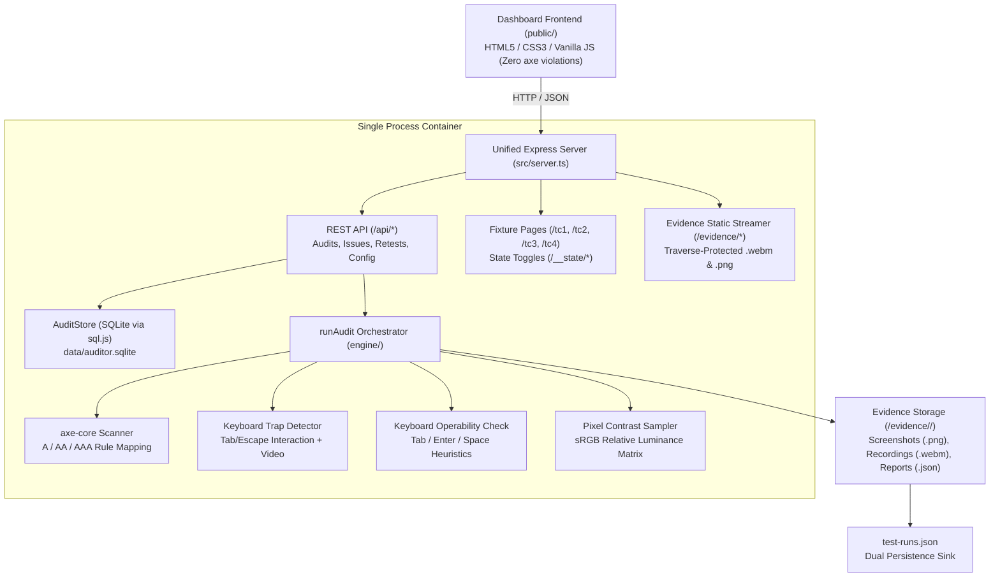

# WCAG Accessibility Auditor

[](https://www.typescriptlang.org/)
[](https://playwright.dev/)
[]()
[-success.svg)]()
[](https://www.docker.com/)

An AI-assisted accessibility evaluation and remediation engine built for the **Ziro.Digital Agentic AI Hackathon 2026**. 

The **WCAG Accessibility Auditor** bridges the critical gap between automated scanners and human accessibility testing. While traditional automated rule engines miss up to 70% of WCAG defects, this auditor combines automated DOM scanning (`axe-core`) with interactive browser automation (`Playwright`) to actively detect keyboard traps with video evidence, verify custom control keyboard operability, and compute visual contrast over photographic backgrounds using pixel sampling.

> [!IMPORTANT]
> **What This System Does NOT Claim:**  
> This system does **NOT** claim full WCAG 2.1 or 2.2 compliance. Only the specifically executed checks are evaluated and claimed. Full compliance requires manual assistive technology testing (screen readers, voice control, cognitive evaluation). For our complete disclosure, read [engine/LIMITATIONS.md](engine/LIMITATIONS.md).

---

## Live Demo & 5-Step Workflow

**Live Deployed URL:** `https://wcag-auditor-demo.fly.dev` *(or run locally on `http://localhost:3000`)*

Follow this 5-step workflow to verify the agent cold:

1. **Collect & Plan:** Enter any target URL or click one of the quick-fill fixture buttons (**TC1 Bad**, **TC2**, **TC3**, **TC4**). Select WCAG Level (`A`, `AA`, or `AAA`) and click **Run audit**.
2. **Inspect Workflow Timeline:** Observe the 4-step workflow banner (**Collect &rarr; Plan &rarr; Find &rarr; Act**). Expand the **Plan & Execution** drawer to view human-readable rationale and check execution durations.
3. **Review Proposed Findings (FR-06):** Review proposed findings before anything is logged to the database. Inspect playable `.webm` interaction recordings and `.png` screenshots. Click **Approve & Log** or **Reject**.
4. **Manage Issues (FR-07):** Navigate to the **Issues** tab to view logged defects, severity ratings, WCAG criteria, and stable 16-hex fingerprints.
5. **Retest & Resolve (FR-08):** Open an issue to inspect its detail modal. Click **Retest** while the page is broken—verify the issue remains **Open**. Click **Deploy Fix**, then click **Retest** again—verify the status cleanly transitions to **Resolved** with side-by-side before/after evidence.

---

## Quick Start

### Prerequisites
- **Node.js:** v18.0.0 or newer (tested on Node v24).
- **npm:** v9.0.0 or newer.

### Installation

```bash
# 1. Clone repository and install clean dependencies
git clone https://github.com/nyx-suk/WCAG.git
cd WCAG
npm ci

# 2. Install matching Playwright Chromium browser binaries
npx playwright install chromium

# 3. Verify types and run test suite
npm run typecheck
npm test
```

### Running Locally

```bash
# Start the unified single-process application (Dashboard, API, Static Evidence & Fixtures)
npm start
```
- Open `http://localhost:3000` in your browser.
- *Default Port:* `3000` (configurable via `PORT` environment variable).
- *Fixture Server:* Built-in fixtures are accessible directly on `http://localhost:3000/tc1/bad`, `/tc2`, `/tc3`, `/tc4`.

---

## System Architecture



---

## How Each Audit Check Works

| Check ID | Target WCAG Rule | Methodology | Artifacts Produced |
| :--- | :--- | :--- | :--- |
| **`axe`** | Various (A, AA, AAA) | Injects `@axe-core/playwright` into the DOM. Maps axe rule tags (e.g. `wcag143`) to formal WCAG rule numbers (`1.4.3`). Generates deterministic 16-hex fingerprints from `ruleId + selector`. | Axe summary JSON with violation/passes counts. |
| **`keyboard-trap`** | **2.1.2 No Keyboard Trap** (Level A) | Launches a dedicated video-recording browser context. Simulates keyboard navigation using Tab and Shift+Tab. Detects cyclical focus loops, tests `Escape` dismissal, and tests interactive dismiss buttons. Distinguishes accessible modal containment from genuine traps. | Playable `.webm` video recording, `.png` screenshot, and cycle sequence telemetry. |
| **`keyboard-operability`** | **2.1.1 Keyboard** (Level A) | Discovers custom interactive controls heuristically (pointer cursors, click handlers, ARIA roles). Verifies whether elements can be focused via Tab and triggered using Enter and Space keys. Identifies button-styled `<div>` elements missed by static tools. | Playable `.webm` video recording, `.png` screenshot of highlighted element. |
| **`contrast`** | **1.4.3 Contrast (Minimum)** (Level AA) | Overcomes CSS static analysis limits on photographic/SVG backgrounds. Captures element screenshots, samples 5x5 pixel grids at computed foreground and background coordinates, and derives relative luminance using standard sRGB transfer functions against the 4.5:1 AA threshold. | `.png` screenshot, annotated crop image with bounding boxes, measured contrast ratio. |

---

## Official Test Cases (TC1–TC4)

All four official test cases strictly adhere to the PRD §10.4 schema and are synchronized across SQLite and root [`test-runs.json`](test-runs.json).

| Case | Test Name & Target URL | Expected Behavior | Actual Outcome | Runner Command | Primary Evidence |
| :---: | :--- | :--- | :---: | :--- | :--- |
| **TC1** | **Modal Traps Focus**<br>`/tc1/bad` & `/tc1/good` | `/tc1/bad` traps Tab focus indefinitely and ignores Escape; `/tc1/good` closes on Escape and restores focus. | **PASS**<br>(Auditor flags 1 critical trap on bad, 0 on good control) | `npm run tc1` | `evidence/test-runs/TC1.json`<br>`evidence/tc1-*/keyboard-trap.webm` |
| **TC2** | **Automated Scanner Gap**<br>`/tc2` (broken state) | axe-core passes with 0 violations; dynamic keyboard operability check flags inaccessible `#add-to-cart` button. | **PASS**<br>(axe violations = 0, keyboard failures = 1) | `npm run tc2` | `evidence/test-runs/TC2.json`<br>`evidence/tc2-*/keyboard-operability.webm` |
| **TC3** | **Visual Contrast on Photo**<br>`/tc3` | Pixel sampling detects white text over light photograph failing the 4.5:1 AA threshold (measured ~1.69:1). | **PASS**<br>(Contrast ratio = 1.69:1 on `#hero-caption`) | `npm run tc3` | `evidence/test-runs/TC3.json`<br>`evidence/official-tc3-*/contrast-annotated.png` |
| **TC4** | **Retest Lifecycle**<br>`/tc4` | Initial failure creates pending issue. Retest while broken maintains issue open (`approved_logged`). Fixed retest resolves issue. | **PASS**<br>(Issue resolved only after fixture fix) | `npm run tc4` | `evidence/test-runs/TC4.json`<br>`evidence/audit_*/official-report.json` |

---

## Retest Workflow & Resolution Rules

The auditor enforces strict retest integrity to ensure defects cannot be accidentally closed:

1. **State Machine:**
   ```text
   [Audit Finding] ──> pending_approval ──> approved_logged ──> [Fix Applied] ──> resolved
                             │                     │                                ▲
                             └──> rejected         └──> [Retest Fails / Incomplete] ┘
   ```
2. **Targeted Execution:** Retesting an issue executes **only** the check that detected it (`checks: [issue.source]`).
3. **Resolution Criteria:** An approved issue transitions to `resolved` **if and only if**:
   - `runAudit` completes with `status: "complete"`.
   - The associated check has `status: "executed"`.
   - Zero findings in the retest match the issue's original 16-hex `fingerprint`.
4. **Integrity Rule:** If the page remains broken, the retest outcome is `"fail"` and the issue stays `approved_logged`. If navigation fails or a timeout occurs, the outcome is `"incomplete"` and the issue stays `approved_logged`. **A failed or incomplete retest never resolves an issue.**

---

## Verification & Testing Commands

Verify the entire repository from a clean clone using these commands:

```bash
# 1. Typecheck: Verify strict TypeScript compilation (0 errors)
npm run typecheck

# 2. Automated Test Suite: Run all 49 unit, integration, and E2E tests
npm test

# 3. Flake Hardening & Repeatability: Run 10 consecutive clean-slate runs of TC1-TC4
npm run repeat

# 4. End-to-End Retest Lifecycle Script:
npm run e2e

# 5. Run Individual Official Test Runners:
npm run tc1
npm run tc2
npm run tc3
npm run tc4
```

---

## Docker & Deployment

The application deploys as a self-contained container packaging Chromium, Node.js, Express, and static evidence streaming.

### Local Docker Build & Run

```bash
# Build the Docker image (uses official Playwright jammy base)
npm run docker:build

# Run the container locally on port 8080
npm run docker:run

# Check container health status
curl http://localhost:8080/health
```

### Environment Variables

| Variable | Default | Purpose |
| :--- | :--- | :--- |
| `PORT` | `3000` (local) / `8080` (Docker) | HTTP port for server binding. |
| `PUBLIC_BASE_URL` | `http://localhost:${PORT}` | Public domain (e.g. `https://my-app.fly.dev`). In browsers, defaults to `window.location.origin`. |
| `ADMIN_TOKEN` | *None* | Secret token protecting the `POST /api/admin/reset` endpoint. |
| `RESET_ON_STARTUP` | `false` | When `"true"`, wipes SQLite database and resets fixtures to clean demo state on boot. |
| `DATABASE_PATH` | `data/auditor.sqlite` | SQLite database file location. |
| `HEADLESS` | `true` | Set to `false` locally to view Playwright browser interactions during audits. |

### Memory Sizing Note for Cloud Hosts
Headless Chromium with video recording requires **minimum 1.0 GB RAM** (ideally 1.5–2.0 GB). On container hosts (Fly.io, Railway, Render), ensure instances are configured with at least `1024mb` or `2048mb` RAM to prevent memory pressure (`SIGKILL` / Exit Code 137).

---

## Limitations & Non-Claims

For complete architectural details, read [`engine/LIMITATIONS.md`](engine/LIMITATIONS.md):
- **Heuristic Control Discovery:** Keyboard operability uses DOM heuristics for clickable targets and pointer styles. Custom widgets without accessible semantics or pointer cues may require manual designation.
- **Keyboard Trap Scope:** Trap detection focuses on modal dialogs, overlays, and popups. Traps inside non-dialog embedded canvas or plugin widgets are outside scope.
- **Contrast Sampling Scope:** Targeted at text over static images and SVG vectors; does not sample video streams or animated CSS backgrounds.
- **Axe AAA Rules:** Automated rule coverage for WCAG AAA criteria is partial per axe-core capabilities.

---

## License

This project is licensed under the MIT License - see the [LICENSE](LICENSE) file for details.
